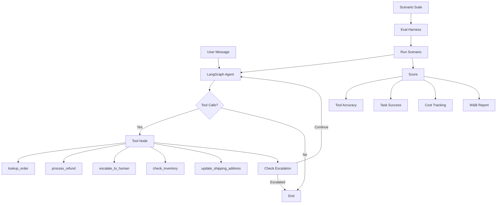

# Agent Eval Harness for Customer Workflows

A tool-calling support agent built with LangGraph, plus an evaluation harness that replays scripted conversations and scores each run on task success, tool-call accuracy, and cost.

## Architecture



## Measured Results

### Scoring pipeline verification (mock traces)

The scoring pipeline was evaluated end-to-end against all 50 scenarios
using synthesised tool-call traces (no LLM). Three trace variants test
that the scorer distinguishes correct, partially-wrong, and fully-wrong
agent behaviour:

| Variant | Success Rate | Tool Accuracy | Efficiency | Mean Cost/Task |
|---------|-------------|---------------|------------|----------------|
| **Perfect traces** (baseline) | 100.0% (50/50) | 100.0% | 100.0% | $0.0002 |
| **Degraded traces** (1 missed + 1 spurious tool) | 24.0% | 37.7% | 99.0% | $0.0002 |
| **Wrong traces** (completely wrong tools) | 18.0% | 11.3% | - | - |

**Regression detection**: the checker caught 4 regressions across two
degradation levels (success-rate drop and tool-accuracy drop for each).

**Note**: these numbers measure the *scoring and regression-detection
pipeline*, not a live LLM agent. Running the full harness against an LLM
(`agent-eval run --scenarios ...`) requires an `OPENAI_API_KEY` and will
produce agent-level metrics; the scoring code exercised here is the same
code path used in that live run.

### Live agent evaluation

To produce agent-level metrics, run the harness with a live LLM:

```bash
export OPENAI_API_KEY=your-key
agent-eval run --scenarios scenarios/customer_support.json --model gpt-4o-mini
```

The harness scores each conversation on task success, tool accuracy,
efficiency, and estimated cost, then writes results to `results/` and
optionally logs to W&B.

## Setup

```bash
# Clone and install
git clone https://github.com/siddhant-rajhans/agent-eval-harness.git
cd agent-eval-harness
pip install -e ".[dev]"

# Set API key (for live agent evaluation)
export OPENAI_API_KEY=your-key-here
```

## Usage

### Run the scoring pipeline verification (no API key needed)

```bash
PYTHONPATH=src:. python3 scripts/run_e2e_eval.py
```

### Run the full evaluation suite (requires API key)

```bash
# Run all 50 scenarios
agent-eval run --scenarios scenarios/customer_support.json --model gpt-4o-mini

# Filter by tag
agent-eval run --scenarios scenarios/customer_support.json --tag refund --tag escalation

# With W&B logging
agent-eval run --scenarios scenarios/customer_support.json --wandb --run-name "v1.2-prompt-update"
```

### Compare runs for regressions

```bash
agent-eval compare results/baseline.json results/eval_results.json --threshold 0.05
```

## Agent Tools

| Tool | Description |
|------|-------------|
| `lookup_order` | Retrieves order details by ID |
| `process_refund` | Processes full or partial refunds |
| `escalate_to_human` | Creates escalation ticket with priority |
| `check_inventory` | Checks product stock levels |
| `update_shipping_address` | Updates address for pending orders |

## Scenario Format

Scenarios are JSON files with scripted user messages and expected tool calls:

```json
{
  "id": "CS-002",
  "name": "Refund for delivered order",
  "user_messages": [
    "I need a refund for order ORD-1001. The headphones stopped working.",
    "Yes, please process the full refund."
  ],
  "expected_tools": [
    {"name": "lookup_order", "args": {"order_id": "ORD-1001"}},
    {"name": "process_refund", "args": {"order_id": "ORD-1001"}}
  ],
  "expected_outcome": "refund_approved",
  "tags": ["refund"],
  "difficulty": "medium"
}
```

## Evaluation Metrics

- **Task Success** (binary): Did the agent achieve the scenario's intended outcome?
- **Tool Accuracy** (Jaccard): Overlap between expected and actual tool calls.
- **Tool Precision/Recall**: Were the right tools called? Were any expected tools missed?
- **Efficiency**: Ratio of optimal turns to actual turns taken.
- **Cost**: Estimated token cost per task, tracked per model.

## Tech Stack

- **LangGraph** - Agent orchestration with typed state
- **LangChain + OpenAI** - LLM tool calling
- **Pydantic** - Typed tool schemas and validation
- **pytest** - Unit and integration tests
- **W&B** - Experiment tracking and comparison
- **Rich** - Terminal output formatting
