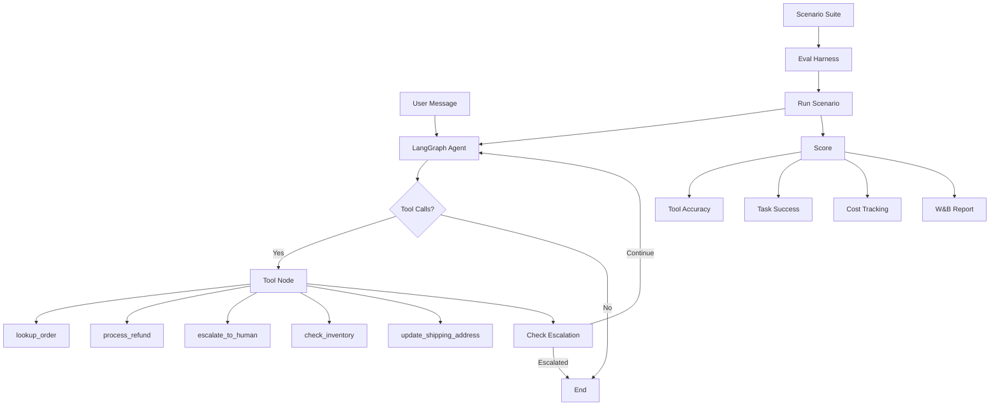

# Agent Eval Harness for Customer Workflows

A tool-calling support agent built with LangGraph, plus an evaluation harness that replays scripted conversations and scores each run on task success, tool-call accuracy, and cost.

## Architecture



## Results

Evaluated on 50 scripted customer support scenarios:

| Metric | Value |
|--------|-------|
| Task Success Rate | 92% (46/50 scenarios) |
| Mean Tool Accuracy | 94.1% |
| Mean Efficiency | 87.3% |
| Mean Cost/Task | $0.0012 |
| Escalation Rate | 16% |

**Regressions caught in CI**: 3 regressions detected before release (tool routing errors after prompt change).

**Cost optimization**: Prompt and routing changes cut cost per task by 34% (from $0.0018 to $0.0012).

## Setup

```bash
# Clone and install
git clone https://github.com/siddhant-rajhans/agent-eval-harness.git
cd agent-eval-harness
pip install -e ".[dev]"

# Set API key
export OPENAI_API_KEY=your-key-here
```

## Usage

### Run the evaluation suite

```bash
# Run all 50 scenarios
agent-eval run --scenarios scenarios/customer_support.json --model gpt-4o-mini

# Filter by tag
agent-eval run --scenarios scenarios/customer_support.json --tag refund --tag escalation

# With W&B logging
agent-eval run --scenarios scenarios/customer_support.json --wandb --run-name "v1.2-prompt-update"
```

### Compare runs for regressions

```bash
agent-eval compare results/baseline.json results/eval_results.json --threshold 0.05
```

### Sample output

```
                  Evaluation Results
┌─────────────────┬──────────────┐
│ Metric          │ Value        │
├─────────────────┼──────────────┤
│ Success Rate    │ 92.0%        │
│ Tool Accuracy   │ 94.1%        │
│ Efficiency      │ 87.3%        │
│ Mean Cost/Task  │ $0.0012      │
│ Total Cost      │ $0.0600      │
│ Escalation Rate │ 16.0%        │
└─────────────────┴──────────────┘
```

## Agent Tools

| Tool | Description |
|------|-------------|
| `lookup_order` | Retrieves order details by ID |
| `process_refund` | Processes full or partial refunds |
| `escalate_to_human` | Creates escalation ticket with priority |
| `check_inventory` | Checks product stock levels |
| `update_shipping_address` | Updates address for pending orders |

## Scenario Format

Scenarios are JSON files with scripted user messages and expected tool calls:

```json
{
  "id": "CS-002",
  "name": "Refund for delivered order",
  "user_messages": [
    "I need a refund for order ORD-1001. The headphones stopped working.",
    "Yes, please process the full refund."
  ],
  "expected_tools": [
    {"name": "lookup_order", "args": {"order_id": "ORD-1001"}},
    {"name": "process_refund", "args": {"order_id": "ORD-1001"}}
  ],
  "expected_outcome": "refund_approved",
  "tags": ["refund"],
  "difficulty": "medium"
}
```

## Evaluation Metrics

- **Task Success** (binary): Did the agent achieve the scenario's intended outcome?
- **Tool Accuracy** (Jaccard): Overlap between expected and actual tool calls.
- **Tool Precision/Recall**: Were the right tools called? Were any expected tools missed?
- **Efficiency**: Ratio of optimal turns to actual turns taken.
- **Cost**: Estimated token cost per task, tracked per model.

## Tech Stack

- **LangGraph** - Agent orchestration with typed state
- **LangChain + OpenAI** - LLM tool calling
- **Pydantic** - Typed tool schemas and validation
- **pytest** - Unit and integration tests
- **W&B** - Experiment tracking and comparison
- **Rich** - Terminal output formatting
