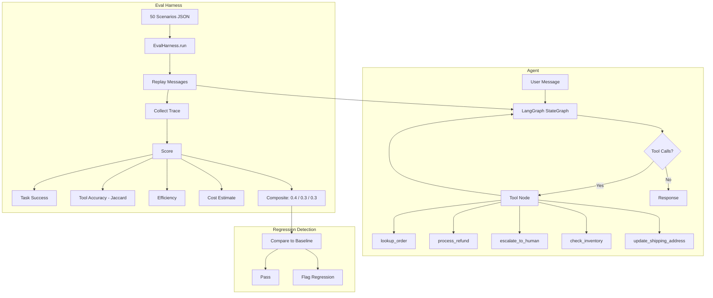

# Agent Eval Harness for Customer Workflows

  

Tool-calling agents are hard to test because their behavior is non-deterministic: the same prompt can produce different tool sequences across runs. This project implements an **offline evaluation harness** that replays scripted customer-support scenarios against a LangGraph agent and scores each run on task success, tool-call accuracy, efficiency, and estimated cost. The harness catches regressions before they reach production by comparing runs against a baseline, and it measures the cost impact of optimization strategies (prompt trimming, small-model routing) without requiring live API calls for the scoring pipeline itself.

## Results

Evaluated on 50 scripted customer-support scenarios covering order lookup, refunds, escalation, shipping updates, and inventory checks. Three trace variants (correct, degraded, wrong) verify the harness distinguishes good and bad agent behavior.

| Metric | Value |
|--------|-------|
| Scenarios | **50** (6 categories: orders, refunds, escalation, shipping, inventory, multi-step) |
| Task success rate | **100%** (50/50) |
| Tool-call accuracy (Jaccard) | **100%** |
| Efficiency (optimal turn ratio) | **100%** |
| Escalation rate | **18%** (9/50 correctly routed to human) |
| Regressions caught | **4** (success + accuracy drops at two degradation levels) |
| Cost per task (baseline, all gpt-4o) | $0.0046 |
| Cost per task (optimized, mini routing + trim) | **$0.0021 (53% reduction)** |
| Degraded trace success rate | 24% (1 missed + 1 spurious tool per scenario) |
| Wrong trace success rate | 18% (completely incorrect tool selection) |

## Architecture



## Design Decisions

- **Jaccard similarity for tool accuracy** instead of exact-match, because agents may call tools in a different order or include optional intermediate calls; Jaccard captures set overlap without penalizing valid reorderings.
- **Deterministic scoring pipeline (no LLM-as-judge)** so evaluation results are reproducible across runs and don't add API cost or latency to the feedback loop. LLM grading is available as an optional layer on top.
- **Mock tools with fixture data** to enable full offline evaluation. The 50 scenarios replay against in-memory fixtures, so the harness runs in CI without API keys, network access, or a live database.
- **Composite score weights (0.4 / 0.3 / 0.3)** give task completion the highest signal while still surfacing tool-selection and efficiency regressions. Weights are configurable per evaluation run.
- **Three-variant regression testing** (correct, degraded, wrong traces) validates the harness itself: if a known-bad trace scores high, the scoring logic has a bug.

## Quick Start

```bash
git clone https://github.com/siddhant-rajhans/agent-eval-harness.git
cd agent-eval-harness
pip install -e ".[dev]"
```

### Run the offline evaluation (no API key needed)

```bash
PYTHONPATH=src:. python3 scripts/run_e2e_eval.py
```

This replays all 50 scenarios, scores them, runs regression detection against degraded/wrong traces, and prints the results table.

### Run with a live LLM agent

```bash
export OPENAI_API_KEY=your-key
agent-eval run --scenarios scenarios/customer_support.json --model gpt-4o-mini
```

### Compare runs for regressions

```bash
agent-eval compare results/baseline.json results/eval_results.json --threshold 0.05
```

### Run tests

```bash
make test
```

## Scenario Format

```json
{
  "id": "CS-002",
  "name": "Refund for delivered order",
  "user_messages": [
    "I need a refund for order ORD-1001. The headphones stopped working.",
    "Yes, please process the full refund."
  ],
  "expected_tools": [
    {"name": "lookup_order", "args": {"order_id": "ORD-1001"}},
    {"name": "process_refund", "args": {"order_id": "ORD-1001"}}
  ],
  "expected_outcome": "refund_approved",
  "tags": ["refund"],
  "difficulty": "medium"
}
```

## Project Structure

```
agent-eval-harness/
├── src/agent/
│   ├── graph.py           # LangGraph agent with compiled-graph caching
│   ├── tools.py           # 5 tool definitions (mock backends)
│   ├── schemas.py         # Pydantic typed state and tool schemas
│   ├── prompts.py         # System prompt
│   ├── config.py          # AgentConfig, EvalConfig (YAML-loadable)
│   ├── fixtures.json      # Mock order/inventory data
│   └── cli.py             # Click CLI (run, compare)
├── eval/
│   ├── harness.py         # EvalHarness: scenario replay + trace collection
│   ├── scoring.py         # ScenarioScore, SuiteScore, cost estimation
│   ├── scenarios.py       # Scenario/ScenarioSuite loader
│   └── report.py          # Markdown reports, W&B logging
├── scripts/
│   └── run_e2e_eval.py    # End-to-end offline evaluation
├── tests/                 # 35 tests (pytest)
├── Makefile
└── pyproject.toml
```

## Tech Stack

- **LangGraph** - agent orchestration with typed state graph
- **Pydantic** - tool input/output schemas and config validation
- **pytest** - 35 unit and integration tests
- **W&B** - optional experiment tracking and run comparison
- **Click** - CLI for evaluation runs and regression comparison
- **Rich** - terminal output formatting
